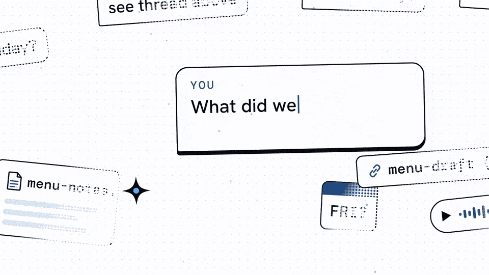

# Nave AI Workspace

**Give your AI employees a place to do their best work.**

Bring your business knowledge, projects and saved memory together, so you and your AI employees can work from a shared understanding of what matters and what comes next.

Nave AI Workspace is the home for your work with AI. Keep your projects organized, your decisions easy to find and the context your agents need close to the work. Start with your own business, then add clients and departments as your needs grow.

Create your own private copy and shape it around your business. Each business has its own context, projects and memory; shared methods help your agents pick up the work across sessions. Nave can join that workspace as your content department when you need it.



**[Watch the overview with sound](docs/media/ai-workspace-explainer.mp4)**, or watch the complete silent overview above. See how a saved decision carries into the next session, and where your content department fits. [Video details](docs/README-VIDEO.md).

## Choose your harness and model

**Keep your work as you change the AI tools you use.** Your projects, knowledge and saved memory live in your own files. Claude Code, Codex, OpenClaw, Hermes or another capable harness can work from that same foundation. A harness is the app that gives an AI access to your files and tools.

Use a hosted model or a model running locally through a harness that supports it. The model needs the instruction following, context capacity and tool use required for your work. Claude Code and Codex have generated adapters here; other harnesses use their supported skill discovery or read the instructions by path. Hooks and other integrations vary by harness. [Setup routes and compatibility details](docs/HARNESSES.md).

## Build continuity into the way you work

Good work depends on more than the next answer. It depends on knowing your business, understanding the project and carrying decisions forward.

Your positioning, current priorities, unfinished drafts and lessons from earlier work all need a home. The workspace helps you keep those records together so the next session can build on what you saved. Over time, you can develop a working knowledge base that supports the way you and your AI employees operate.

| What you need | What the workspace helps you do |
|---|---|
| A shared understanding of your business | Keep your goals, audience, offers and approved decisions together. |
| Projects you can pick up again | Find the current work, its status and the next useful step. |
| Memory across sessions | Save decisions, lessons and handovers for your agents to read when you return. |
| Room for more than one business | Give each business or client its own projects, context and memory. |

You direct the work. Your AI employees are the agents you work with through your chosen harness; the workspace gives them an organized place to find context and leave a useful record.

## Add Nave as your content department

The workspace holds the bigger picture of your business. **[Nave — Content OS](https://github.com/agentic-ai-content/nave)** adds a team of AI employees for content: research, planning, writing, production, editing and learning from the results you record.

Together, they give your content work a home inside the business it serves. Your ideas, voice and brand knowledge can inform the next piece, while projects and saved memory keep the work connected across sessions.

Nave's skills cover six stages: **foundation, pre-production, production, post-production, distribution and learning**. They help you establish the brand, develop the idea and script, make and edit the piece, publish what you approve and keep useful lessons. Use the stage your task needs; a writing job does not require a full production run.

Its local panel brings the saved work into view: a content calendar and production board, business and content memory, skills, tool observations and a creative library. Your agent works through the skills and saves the results; the panel helps you inspect them and choose what to do next. [Explore the stages and panel](https://github.com/agentic-ai-content/nave#see-the-work-in-the-nave-panel).

This workspace template is optional. If you already have a workspace, you can install Nave there as a private content department. If you want a fresh structure for your business, start here and add Nave separately when you are ready. [How they fit together](docs/CONTENT-OS.md).

Both are built by **Agentic AI Content**, where we learn to put AI agents to work for content and social media, and earn from what we build. The opportunity comes from the work you choose to do; income is not guaranteed.

## Set up your first business

1. Confirm your GitHub account can open this private template. Select **Use this template**, then create your own private repository named `<your-brand>-ai-workspace`.
2. Clone it into a **regular folder you own**, for example `Documents/<your-brand>-ai-workspace`. Never inside a tool folder (`Codex/`, `.codex/`, `.claude/`), never inside another repository, never in a cloud folder that keeps files "online only".
3. Open **that folder itself** in your chosen harness (the one that contains `AGENTS.md`, not a parent). Claude Code and Codex have included adapters; for OpenClaw, Hermes or another harness, follow [the setup route](docs/HARNESSES.md#other-harnesses).
4. Say **"set up my workspace"**. If your harness does not discover the skill, ask it to read `AGENTS.md` and follow `.agents/skills/workspace-onboard/SKILL.md`. Answer the interview and approve the proposed files.
5. Use the `continue` skill at the start of each session and `done` at the end. In Claude Code: `/continue`, `/done`; in Codex: `$continue`, `$done`. Other harnesses can follow the same skills by path.

No dependencies for the workspace itself. Node.js is needed only for the validator and the sync tools.

```sh
node system/tests/validate.mjs                  # registry, business folders, required maps, location warnings
node .agents/tools/harness-bridges.mjs check    # host folders in sync with the canonical layer
```

**Access:** Nave AI Workspace and Nave are separate private repositories. Confirm your GitHub account can open each one you need. The workspace does not include or install Nave automatically.

## How it works underneath

The workspace runs in your own folder. Its memory comes from the records you and your agents save and read; it does not retrain a model or start a team working on its own. Client folders organize separate work, but are not a security sandbox.

<details>
<summary>Explore the structure, memory process and included skills</summary>

`AI WORKSPACE TEMPLATE · 0.3.5 · OCTOBER 2026`

| The agent needs | The workspace gives it |
|---|---|
| To know where it is and what it may touch | One operating map (`AGENTS.md` = `CLAUDE.md`) at the root, one per business, one per installed department |
| Your facts, kept apart from its guesses | `businesses/<brand>/context/` for approved facts; each client has its own context under `businesses/clients/<client>/` |
| To remember between sessions | Daily minutes, a bank, a wiki and a handover for the business; an installed Nave department keeps its own content minutes, bank and handover |
| To resume without re-reading everything | `/continue` selects a business and reads its map, handover, recent minutes, memory indexes and open tasks; a named route can add that department's entry documents. |
| To leave the next session in good shape | `/done` promotes durable lines to the bank, ingests the day into the wiki, writes the newest handover block, updates the task, offers a scoped commit |
| To use the same methods in Claude Code and Codex | Skills, hooks and tools are authored once under `.agents/`; the sync tools generate each host’s adapters. Host capabilities and hook setup still differ. |
| A place where content actually gets made | `businesses/<brand>/departments/content/` holds your installed content department; your brand data lives beside the engine in `nave-content-os/` and stays in place during reviewed engine updates |

## The functionality, piece by piece

**One map, two names.** `AGENTS.md` is what Codex reads, `CLAUDE.md` is what Claude Code reads, and they are byte-identical at every level: root, business, department. You never maintain two versions. The validator refuses a workspace where they differ.

**Eight skills, written once.**

| Skill | What it does | Invoke |
|---|---|---|
| `workspace-onboard` | First-run interview: your name, the business, its shape (personal brand, company, agency, several brands), the first useful result, the departments you actually run, the harness, existing material, whether you run content as a department. Shows every file before writing it. Creates only what you confirmed. | "set up my workspace" |
| `business-onboard` | Adds one more business or client in the same shape, registered in `system/workspace.json`. | "add a client" |
| `continue` | Resumes one business: bounded reads, one recommended next action. `continue content` hands off to that business's content department. | `/continue` · `$continue` |
| `done` | Closes the session: capture, promote, handover, close. | `/done` · `$done` |
| `context-engine` | The memory discipline: two rooms, the layers inside a room, Retain blocks with `@Entity` tags and trust markers, promotion rules, what never goes in memory. | followed during sessions |
| `llm-wiki` | The business's synthesized knowledge base: ingest, query, lint. One wiki per business, none per department. | "what do we know about X" · "wiki lint" |
| `sync` | Regenerates every host folder for the root and every registered content department from the canonical layer. | `/sync` · `$sync` |
| `push` | Pushes committed work with a token read from the gitignored `.env`, never printed, never in chat. | `/push` · `$push` |

**Two optional hooks, one manifest.** When enabled and supported by the host, `session-start` prints the registry and newest handover and starts the watcher; `after-edit` re-syncs after canonical changes. Both are declared in `.agents/hooks/hooks.json` and rendered for Claude Code (`.claude/settings.json`) and Codex (`.codex/hooks.json`). Check host trust and actual hook execution; files alone do not activate them.

**Shared tools.** `harness-bridges.mjs` renders and checks generated host files. `harness-watch.mjs` keeps them synchronized while running; the included VS Code task or an enabled session-start hook can launch it. These tools need Node.js. `git-push.mjs` also needs Git and authorized repository access; it masks the configured token in its output. You can run the sync check manually when hooks or the watcher are unavailable.

**A registry the tools read.** `system/workspace.json` names the operator, the businesses, their paths and installed departments. `system/tests/validate.mjs` checks it, the business folders, the required maps, and warns when the workspace sits in a tool folder, inside another repository or in a cloud "online only" folder. `system/operations/` is an opt-in helper for cooperative task ownership with revision-checked checkpoints when more than one session works the same business.

**A business folder standard.** Every business has the same shape, so a skill never has to guess:

```text
businesses/<brand>/                (or businesses/clients/<client>/)
├── AGENTS.md · CLAUDE.md          first line: "<Brand> workspace"
├── README.md · business.json
├── context/                       approved current facts
├── departments/                   only the ones you run; content/ can hold Nave
├── projects/                      cross-department work
├── memory/                        YYYY-MM-DD.md minutes · bank/ · wiki/
├── handover.md                    newest block first
└── routines/ · sessions/ · tasks/
```

</details>

## What is inside

```text
<your-brand>-ai-workspace/
├── AGENTS.md · CLAUDE.md      the operating map (identical)
├── .agents/                   skills · hooks · tools — canonical, host-neutral
├── .claude/ · .codex/         generated adapters (never edit by hand)
├── businesses/<your-brand>/   context · departments · projects · memory · handover · tasks
├── docs/                      architecture · memory · harnesses · development · Content OS · the video
└── system/                    workspace.json · policies · workflows · operations · tests
```

## Documentation map

| Need | Read |
|---|---|
| The map every session loads | [AGENTS.md](AGENTS.md) |
| Every folder and why it exists | [docs/ARCHITECTURE.md](docs/ARCHITECTURE.md) |
| How the agent remembers | [docs/MEMORY.md](docs/MEMORY.md) |
| Harnesses, local models and shared files | [docs/HARNESSES.md](docs/HARNESSES.md) |
| How Nave fits and where to get access | [docs/CONTENT-OS.md](docs/CONTENT-OS.md) |
| Changing the template, running checks, cutting a release | [docs/DEVELOPMENT.md](docs/DEVELOPMENT.md) |
| The README video: claims, sources, regeneration | [docs/README-VIDEO.md](docs/README-VIDEO.md) |
| The setup video script | [VIDEO-GUIDE.md](VIDEO-GUIDE.md) |
| Boundaries | [system/policies/operating-boundaries.md](system/policies/operating-boundaries.md) |
| Versions | [VERSION](VERSION) · [CHANGELOG.md](CHANGELOG.md) |

<p>
  <a href="https://www.youtube.com/@enriquemarq-0"></a><br>
  Created by <a href="https://www.youtube.com/@enriquemarq-0">Enrique</a> for Agentic AI Content.
</p>

A private template; the instances you create from it are yours.
